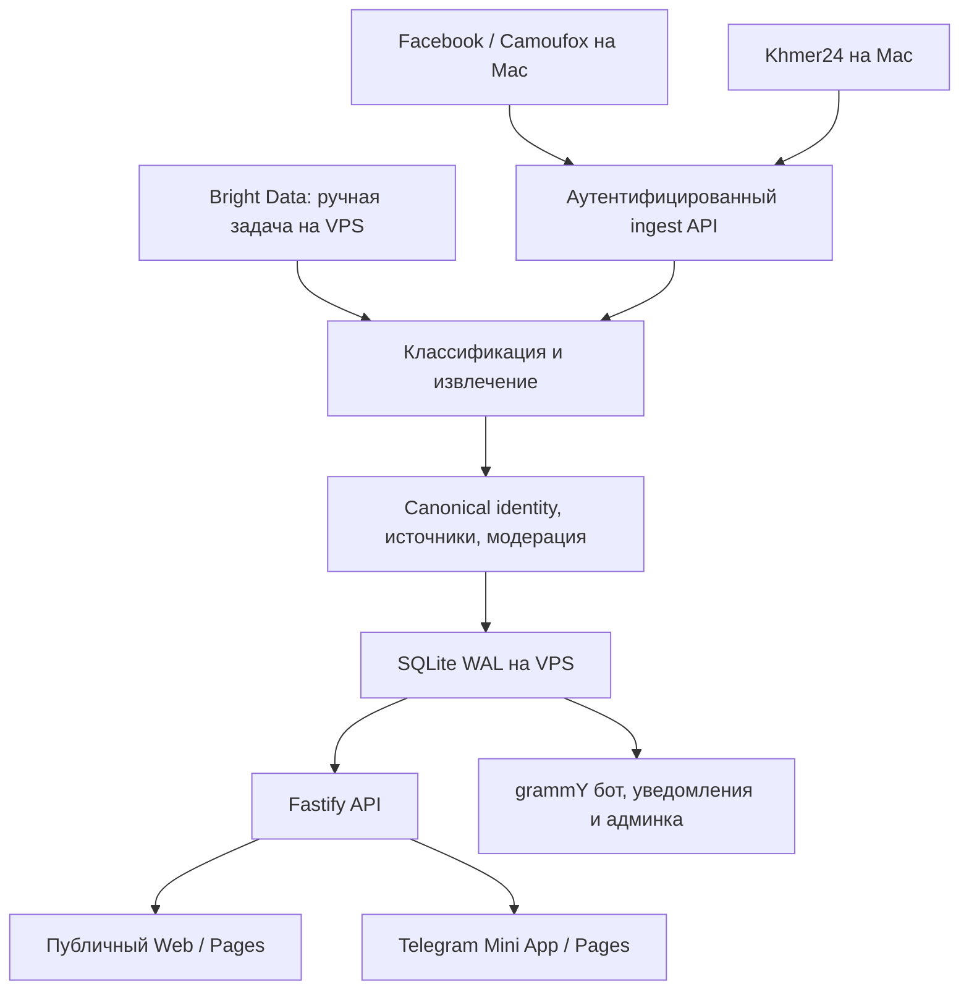

# Homeasy: аудит системы и маршрут к рабочему релизу

**Дата:** 21 ноября 2026 (Камбоджа). **Код:** локальная ветка `main`, HEAD `7ad0ec7` от 23 октября плюс большое незакоммиченное рабочее дерево. **Метод:** чтение актуальных инструкций, решений, исходников, тестов и эксплуатационных отчётов; локальные проверки; read-only просмотр публичных Web/TMA/API через проектный браузер. Живая SQLite, процессы сбора, платные AI/провайдеры, Docker и продакшен не изменялись.

Четыре read-only проверки подсистем были поручены GPT-6 Luna/high; их вызовы инструментов зависли до результатов по коду. Они вернули ограничения или сверку документации, поэтому технические выводы ниже основаны на самостоятельной проверке координирующего агента и перечисленных командах. Независимый code review этим аудитом не заявляется.

> Этот документ — карта для следующего входа в проект. Решения и разрешения остаются в `agent_docs/decisions.md`, последние подтверждённые продакшен-факты и приоритеты — в `agent_docs/project_progress.md`, короткий handoff — в `agent_docs/latest_session_work.md`. Все числа ниже имеют дату и уровень доказательства. Старые `HOMEASY_AUDIT.md`, `reports/homeasy-full-audit-20261022.md` и `HOMEASY_ROADMAP.md` — исторические срезы или продуктовая гипотеза.

## 1. Вывод для владельца

Homeasy уже работает как **публичный каталог аренды в Сием Рипе**, доступный в браузере и Telegram Mini App. Есть накопленный инвентарь, API, бот, модерация, источники объявлений, аналитика и резервное копирование. По последнему документированному снимку VPS от 12 ноября: 591 canonical-карточка (399 Approved, 185 Pending, 7 Rejected), 2516 source items; API тогда показывал 264 публикации. **Свежая браузерная проверка 21 ноября:** Web и TMA показывают по 219 объявлений, API health/catalog — HTTP 200. Это не новый подсчёт строк SQLite; происхождение разницы 264→219 требует отдельной read-only сверки правил свежести, статусов и источников.

Главная проблема для пользовательского запуска — доверие к карточке: на первой странице Web обнаружены 32 подстановки `Photo unavailable` после 403 от Facebook CDN; ранее установлено, что прямые подписанные ссылки на фото истекают. География и точность pin также расходятся с оригиналами в части старого снимка. Сбор данных сейчас включает ручные операции: регулярное свежение инвентаря нельзя считать действующим только потому, что однократные импорты успешно прошли. Локальный код и опубликованные образы нельзя автоматически считать идентичными: множество изменений не зафиксировано в Git, а исправление moderation v13 в текущем worker-контейнере, согласно handoff, отсутствовало в собранном образе.

Практическая цель ближайшего релиза: **надёжный, понятный публичный каталог с проверяемой свежестью и рабочими контактами**, без обещания завершённого marketplace. `DemandCandidate → подтверждённый Request → предложение агента → согласованное раскрытие контакта` — следующий продуктовый этап после проверки качества каталога и реального спроса; наличие некоторых таблиц/модулей не означает готовый пользовательский сценарий.

## 2. Как работает система

- **Исходники и факты.** Mac сохраняет Facebook session/fingerprint и собирает Facebook через Playwright/Camoufox; там же доступен ручной Khmer24 remote-сбор после проблем с датацентровым egress. Отправка на VPS идёт через токенизированные batch endpoints и локальные outbox, чтобы повторить передачу при сбое. Bright Data запускается отдельно вручную через Telegram-контроль и VPS worker, с лимитом/стоимостью; это не бесплатный постоянный cron.
- **Нормализация.** TypeScript классифицирует supply/demand/irrelevant, использует AI-каскад и source-backed извлечение, сверяет идентичности/повторы, ведёт source items/versions/occurrences и canonical property/listing. Правила moderation не публикуют спорные карточки автоматически; 30-дневное правило основано на публикации оригинала, а не на очередном появлении в ленте.
- **Чтение.** Fastify читает canonical-каталог для списка, карты, detail, фильтров и Telegram Saved; гостевой Web Saved хранится локально в браузере. Web и TMA — две сборки одного React приложения с разными поверхностями. Контакты ведут к автору напрямую (Telegram/`tel:`/условный WhatsApp); это ещё не подтверждённый закрытый лид.
- **Эксплуатация.** VPS Compose держит API/бот/worker/SQLite-файлы/backup/tunnel, Pages раздаёт два фронтенда, PostHog EU получает события после согласия. Mac и VPS — разные зоны ответственности: Facebook identity нельзя переносить на VPS.

Навигация для повторного входа: `agent_docs/current_context.md` → `project_progress.md` → `decisions.md` → `latest_session_work.md` → нужный код (`src/modules/parser/`, `src/modules/ai/`, `src/database/`, `src/modules/api/`, `src/modules/bot/`, `webapp/src/`, `deploy/vps/`). Не начинать новый аудит с исторических логов или локальной `data/homeasy.db`: она старее VPS-снимка.

### Карта реализованных модулей

| Узел | Текущий код и контракт | Уровень готовности |
| --- | --- | --- |
| Facebook с Mac | `facebook.scraper.ts`, `fb-runtime.ts`, `facebook-outbox.ts:25–109`; batch пишется сначала в приватный JSON-outbox и удаляется только после полного ответа. VPS endpoint `facebook-ingest.routes.ts:17–61` проверяет Bearer token, источник и лимиты 10 записей/1 MiB. | Есть защитный путь и тесты; фактическая последняя Mac-сессия/расписание не проверены. |
| Khmer24 | `khmer24.scraper.ts`, `khmer24-outbox.ts:8–30`, `khmer24-ingest.routes.ts:17–64`; ручной remote batch по 5, ACK/повтор. VPS Compose всё ещё описывает Khmer24-only scraper (`docker-compose.yml:86–115`, `src/scraper-vps.ts`). | Последний ручной Mac прогон подтверждён 12.11; фактическая деятельность VPS цикла и его egress сегодня не проверены. |
| Bright Data | `src/brightdata-worker.ts:37–110` берёт подтверждённую job, запускает существующие TS scripts и только после collection validation классифицирует результат. `src/services/brightdata-job-control.ts` хранит состояние задач. | Подтверждены отдельные оплаченные/восстановленные one-off задачи; постоянный source feed не включён. |
| Identity/SQLite | `src/container.ts:64–90` связывает repos, matcher, ingestion и alerts; `src/database/db.ts:29–47` включает WAL, busy timeout и FK; миграции `src/database/migrate.ts` содержат source items/versions, canonical, moderation, demand и лёгкие interest/offer/grant таблицы. | Есть данные и тесты; текущая продакшен-инвентаризация/целостность не перепроверялась. |
| Публичная выдача | `canonical-listing.repo.ts:201–221,271–305` требует supply, active, доступность, свежесть оригинала и Approved; `:447–489` собирает подпись, location key, медиа, контакты и GPS. `properties.routes.ts` отдаёт list/map/detail. | HTTP жив; качество фото/гео и причина разницы по когортам открыты. |
| Telegram / Web / API | `server.ts:35–84` регистрирует CORS, rate limit, публичные и auth маршруты; `auth.ts:27–119` проверяет HMAC и возраст initData; `webapp/src/services/platform.ts:1–8` разделяет поверхности, `vite.config.ts:6–13` разделяет сборки. | Публичный Web работает в браузере; Telegram SDK/WebView нужен реальный тест на телефоне. |
| Saved, contacts, analytics | `saved-store.ts:1–65` хранит гостевые ref в браузере, Telegram Saved идёт через API; `contact-actions.ts:13–63` открывает Telegram/нативный звонок/условный WhatsApp; `analytics.ts:35–50,93–125` ограничивает события согласием и allowlist. | Локальные тесты и прежний браузерный smoke есть; реальные device handoff и сквозная конверсия в аренду не доказаны. |
| Резервное копирование | `docker-compose.yml:5–30`, `backup-worker.ts:14–16,63–105`: отдельный процесс, 12-часовая попытка, 30-минутный retry, health по возрасту до 24 часов. | Код и прошлые restore-репетиции есть; сегодняшняя свежесть копии и полный RTO неизвестны. |

**Точный смысл текущего `Interest → Request → Offer → ContactGrant`:** `interests.repo.ts:16–81` одной транзакцией создаёт все четыре записи при одном authenticated интересе к конкретному listing; API `interests.routes.ts:77–108` вызывается только с Telegram initData. `interest_requests` имеет лишь `active|closed`, `listing_offers` автоматически создаёт `LISTING_MATCH` на то же объявление (`migrate.ts:996–1030`). Здесь нет отдельного выбора агента, подтверждённой потребности с датой переезда, проверки наличия жилья или согласованного обмена контактами сторон. Эта минимальная воронка полезна для аналитики, но не заменяет сценарий из долгосрочного roadmap.

## 3. Что подтверждено и что остаётся неизвестным

| Область | Подтверждение на 21 ноября / последнее датированное свидетельство | Граница |
| --- | --- | --- |
| Web, TMA, API | Обе страницы загрузились и показали 219 rentals, начальные 20 карточек; браузерный GET `/health` и каталог вернули 200. | Реальный Telegram WebView, звонок и WhatsApp на телефоне не тестировались этим аудитом. |
| Данные и модерация | VPS 12.11: 591 canonical, 399/185/7, 264 опубликованы; `quick_check=ok`, FK=0 по сохранённому handoff. | Сегодняшние SQLite totals, возраст backup и причина 219 не проверялись. |
| Изображения | На первой странице Web 32 `Photo unavailable`; одновременно в консоли 32 ответа 403 от `fbcdn.net`. Старое исследование доказало истечение signed URL на выборке. | Не измерена доля по всем 219 карточкам и не доказана работоспособность универсального обновления. |
| География | Read-only снимок 11.11: 236 видимых, 197 со строгим сангкатом, 39 без него, 90 исходных подписей; две «точные» AI-координаты без подтверждения первоисточником. | Это старый cohort, сегодняшнее распределение не измерено. |
| Pending | Снимок 11.11: 153 Pending; локальная консервативная симуляция даёт 7–11 кандидатов без причин, выявлены сбои двух AI-пакетов. | Сегодня Pending было 185 уже 12.11; предварительный список 7–11 не разрешает автоматическое изменение статусов. |
| Исходники и выкладка | `main` HEAD 23.10; более поздняя работа затрагивает 58 tracked-файлов и множество untracked. Web r12 и TMA r7 опубликованы по handoff 12.11. | Нет воспроизводимого соответствия одного Git commit всем действующим исходникам, Docker-образам и Pages artifact. |
| Локальные проверки | `npm run typecheck`, backend lint, frontend lint: exit 0 (у frontend 8 warning); Jest 99/99 suite, 1092/1092 tests; Vitest 14/14 file, 185/185 tests; `build:web` и `build:tma` успешны. | Jest сообщил о незакрытом async handle; тесты не доказывают живой scrape, мобильный WebView или deployed image. Карта в обоих build выдаёт предупреждение о chunk 1.21 MB. |

Системный `curl` и web search не смогли разрешить эти домены из среды агента; **это не свидетельство простоя**: проектный браузер успешно загрузил страницы и сделал CORS-доступные API GET. Текущее HTTP-наблюдение ограничено этим браузером и временем проверки.

## 4. Что мешает назвать каталог зрелым продуктом

| Приоритет | Наблюдение / риск | Следующий проверяемый шаг |
| --- | --- | --- |
| P0 | Подписанные фото Facebook недоступны после истечения; реальные карточки выводят пустые галереи. | Посчитать долю по актуальному публичному списку; на небольшом read-only/source sample подтвердить способ повторного получения и сохранения фото/ссылок, затем отдельный ограниченный ремонт с откатом. Не подменять подписи и не запускать платный массовый сбор по догадке. |
| P0 | Воспроизводимость релиза: локальные правки, production artifact и Docker image разошлись; текущий worker hotfix может исчезнуть при recreate старого образа. | Инвентаризировать точный diff и приватные файлы, собрать образ из проверенного commit, прогнать изолированные тесты, записать manifest версий и rollback; только после этого обновлять worker в согласованное окно. Не `git add .`. |
| P1 | 264 публикации 12.11 против 219 сегодня; регулярный свежий supply не подтверждён. | Read-only сверить cohorts: возраст оригинала, активность источника, статус, город/тип, причины скрытия, даты последних успешных Mac/VPS jobs; определить управляемый ритм обновления и показатель свежести. |
| P1 | Свободные геоподписи расходятся с фильтром; несколько «точных» точек без source provenance. | Локальный preview по отчёту 12.11: строгое административное поле отдельно от сырой строки/ориентира, точка только при подтверждённой авторской геоссылке или координатах. Проверить affected IDs перед любым write. |
| P1 | Большой Pending и all-or-nothing AI batch могут задерживать публикацию хороших объявлений; защитные удержания при конфликтах нужны. | Показать воронку source→classification→extraction→approved/pending по актуальному snapshot; исправлять конкретные причины и ограниченный набор ID, сохраняя ручные holds и source evidence. |
| P1 | Не закрыта реальная приёмка телефонов и восстановление после сбоя. | Проверить Android/iOS Telegram cold launch, bot menu, Saved/auth, deep links, dialer/WhatsApp, карту→detail; затем реальный возраст snapshot и изолированный restore/rollback согласно существующему runbook. |
| P2 | Старые docs и продуктовые черновики смешивают Mac-only прототип, уже завершённый cutover и ещё не построенный marketplace. | Использовать этот audit + короткие `agent_docs/` как entry, обновлять только owning documents после каждого этапа, не объявлять исторический чеклист новым разрешением. |

Продуктовые границы: каталог позволяет искать и связываться с автором, но **не гарантирует актуальную доступность жилья, ответ агента или факт аренды**. Сохранённый фильтр/интерес/клик не равен подтверждённому Request; модель Offer/ContactGrant из roadmap не готова как сквозной публичный сценарий. Монетизация в `MONETIZATION.md` — черновик с вариантами, а не принятая модель оплаты или доказанный спрос.

## 5. Последовательность до «продовой версии»

Это план **каталожного MVP для реальных пользователей**, а не обязательство сразу построить весь demand-first marketplace. Каждый этап завершает один измеримый результат; конкретные production writes/сбор/платные вызовы обсуждаются в пределах выбранной операции и существующих решений владельца.

1. **Зафиксировать release baseline.** Разобрать dirty tree на исходники, локальные эксперименты и приватные данные; сохранить нужные изменения в контролируемом Git commit без `data/`; собрать воспроизводимые VPS/Pages artifacts. Проверить, что worker image включает moderation v13, а manifest указывает версии API, bot, worker, Web и TMA. Результат: повторяемая сборка и известный откат.
2. **Выяснить состояние выдачи.** На свежем read-only VPS snapshot построить таблицу 591→264→219 с датами и причинами исключения, разложить Pending по причинам, оценить фото, точность районов и наличие достоверных pin. Результат: не усреднённая «качество нормальное», а список конкретных карточек и исправлений с владельческим выбором ограниченного набора.
3. **Исправить видимые дефекты данных и ритм обновления.** Начать с фото, геоподписей/ложных GPS и безопасного прохождения подтверждённых source facts; сохранить спорные объявления Pending. Закрепить ручной или согласованный периодический Mac/VPS запуск со счётчиками нового/изменённого/ошибочного, возрастом последнего успешного импорта и outbox. Результат: у публичной карточки работают фото/локация/контакт, инвентарь обновляется предсказуемо.
4. **Закрыть релиз и приёмку.** Прогон локальных тестов/обеих сборок, ограниченные браузерные сценарии Web и реальный Telegram на устройствах, CORS/deep links/контакты/согласие на аналитику, проверка свежего backup и restore на отдельной копии, затем развёртывание с rollback. Результат: release checklist с исходными и конечными версиями и журналом проверок, а не только статусом HTTP 200.
5. **Малый пользовательский пилот.** Дать каталог первым реальным арендаторам/агентам, собирать не только pageviews, но и долю успешных контактов, ответы/актуальность 20–30 проверенных объявлений, долю пустых фото и время до нового предложения. Результат: решение, где следующий bottleneck — supply, доверие/контакт или demand.
6. **Только после сигнала пилота — marketplace.** Выбрать один тонкий сценарий подтверждённого запроса и ручного предложения агента; затем Request lifecycle, Offer и явное согласие на раскрытие контакта. Не смешивать с выпуском каталожного MVP. Отдельно проверять правовой/платёжный контур перед monetization.

**Первый следующий шаг:** read-only baseline deployment/data и оценка 219 vs 264 вместе с фото; затем ограниченный план исправлений и релизного соответствия исходников. Никакой широкий reset inventory или автоматическая публикация Pending из этого аудита не следует.

## 6. Доказательства и границы отчёта

- Источник решений: `agent_docs/decisions.md`; последний production handoff: `agent_docs/project_progress.md` и предыдущая версия `latest_session_work.md` (архивирована в `agent_docs/history/` при обновлении handoff).
- История гео и Pending: `reports/homeasy-geography-audit-20261112.md`, `reports/homeasy-pending-v13-city-price-whatif-20261112.md`.
- История Facebook фото: `reports/homeasy-facebook-cdn-http-investigation-20261022.md`, `reports/homeasy-facebook-public-og-refresh-experiment-20261022.md`, `reports/homeasy-brightdata-photo-refresh-research-20261022.md`.
- Операционные инструкции: `deploy/vps/README.md`, `deploy/vps/KHMER24_MAC_RUN_RU.md`, `agent_docs/sqlite_recovery_runbook.md`; QA: `reports/homeasy-telegram-qa-smoke-20261022.md`.
- Свежий Web/TMA/API smoke: проектный браузер 21.11 ~11:38–11:40 ICT, только GET/DOM; карточки 219, API 200, фото 403. Ни одного живого source/browser scrape или платного provider call.
